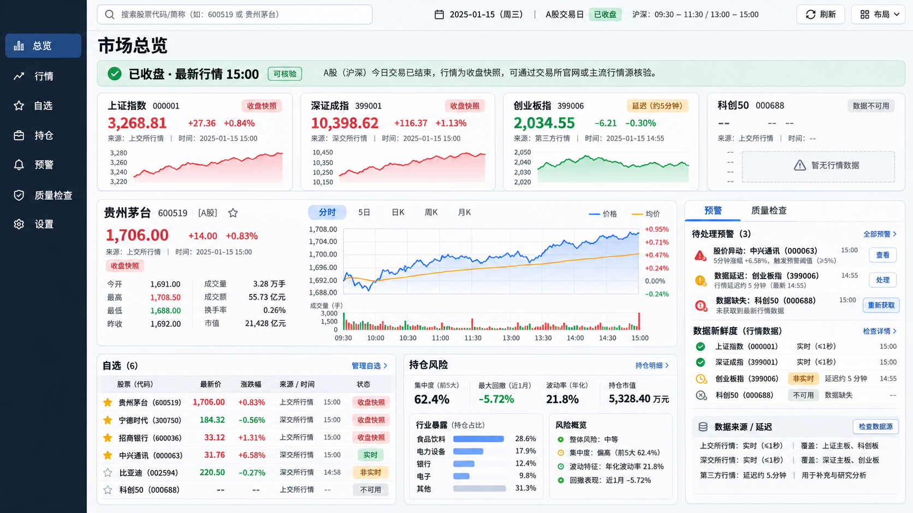

# Stock Workbench 深度审计与实时行情验证报告

> 审计日期：2026-11-07（Asia/Shanghai）
> 审计范围：后端 API、数据网关、调度器、前端构建与工具测试、桌面/移动 UI、真实公共行情源、Docker 配置、实时性与故障降级。
> 结论：项目可以作为“行情研究与人工决策工作台”继续使用；当前还不能把公共行情源包装成交易级实时系统，也没有在真实交易时段完成连续刷新与告警触发认证。

## 1. 认证结论

### 已认证

- 后端全套回归：**762 passed，3 warnings**。
  - 运行环境：本地 Python 3.14.6 虚拟环境；Docker 镜像使用 Python 3.12，另用 Node 24 复核前端契约测试。
  - 覆盖认证、权限隔离、策略、双核卡片、行情降级、持仓、选股池、任务调度、脏数据、用户隔离和接口边界。
- python -m compileall -q backend/app backend/tests backend/scripts：通过。
- 前端统一测试：**21/21 passed**。
  - 双核卡片与页面契约：8/8
  - 选股池行情状态：8/8
  - 持仓行情与北京时间日期：3/3
- npm run build：通过。
  - 主 JavaScript chunk 约 1,030.3 kB，仍有 Vite >500 kB 警告。
- git diff --check：通过。
- Docker Compose 配置：
  - 未配置 JWT_SECRET 时按设计拒绝解析；
  - 注入强 JWT_SECRET 与 FERNET_KEY 后配置可解析。
- 真实公共行情源：
  - 新浪接口成功返回 600000 浦发银行、000001 平安银行的价格；
  - 周末/盘后时段被正确标记为非实时或收盘快照；
  - 盘后快照没有被用于触发盘中预警或授权开仓。

### 尚未认证

当前是周末，以下事实不能用盘后快照代替：

1. 09:30–11:30、13:00–15:00 连续 30 秒刷新是否稳定。
2. 1 分钟行情的延迟分布、断线重连和乱序处理。
3. 14:30 预警、14:45 最终快照和 15:00 后收盘落库的真实触发链。
4. 数据源异常时，前端是否一直保留最后可信数据并清楚标注 stale。
5. 连续运行 4 小时后的线程、锁、连接池和内存表现。

## 2. 测试矩阵

| 层级 | 命令/场景 | 结果 | 证据 |
|---|---|---:|---|
| Python 语法 | `.venv/bin/python -m compileall -q backend/app backend/tests` | PASS | 无语法错误 |
| 后端全套 | 项目 `.venv`，pytest -q | **762 PASS** | 3 warnings |
| 前端工具 | cd frontend && npm test | **21 PASS** | 0 fail |
| 前端生产构建 | npm run build | PASS | 主 chunk 1,030.3 kB |
| Docker 配置 | docker compose config | PASS（注入 secrets） | 缺 JWT 时按设计失败 |
| Docker 生产构建 | 注入强 JWT_SECRET/Fernet 后 `docker compose build` | PASS | 前端构建、Python 依赖、镜像打包均完成 |
| Docker 行情 worker | `--target futu-worker` + `marketdata_worker.py --dry-run` | PASS | Futu SDK 独立镜像、角色与 Redis 配置门禁通过 |
| Redis 行情冒烟 | Redis Streams/latest、带 token ingest、JWT 读取 | PASS | Redis 断开时返回 `storage_unavailable`，不回退内存 |
| Docker 运行冒烟 | 临时容器访问 `/api/ready` | PASS | 返回 `status=ok、database=ok` |
| 浏览器 UI | 桌面 + 移动端 + 选股池移动布局 | PASS（人工检查） | /tmp/stock-workbench-dashboard.png、/tmp/stock-workbench-mobile.png、/tmp/stock-workbench-watchlist-mobile.png |
| 真实行情 | 新浪股票快照 | PASS（盘后） | 价格、来源、时点可读 |
| 交易时段实时 | 连续刷新/分钟线/告警 | 未认证 | 审计日为周六 |

## 3. 本轮已修复

### 数据正确性与安全边界

- 空的日线 DataFrame 现在被视为该源失败，继续走 tx/sina/baostock 降级链，避免短暂缺口被误报为永久缺失。
- 指数日线网关不再硬编码要求至少 30 行；单日或短区间刷新只要返回非空且结构完整即可使用。
- 持仓和自选的价格、止损阈值拒绝负数、NaN、Infinity。
- 双核人工卡片和历史审计中的损坏 JSON 逐行 fail-soft，不再因为一条历史脏记录把整个审计/导出接口打成 500。
- AI 返回合法但非对象 JSON 时进入规则降级；交易日历故障时规则降级不会再因 latest close 查询再次抛错。
- 周报周中不再生成未来周五数据。
- 交易日午休、盘后快照和实时行情在 UI 中分开标识。
- 交易日历异常时，组合行情、持仓视图、日报采取 fail-closed。
- 交易日历异常、空日历或未核验时，收盘写入和 scheduler 统一跳过，并有回归测试。
- 连续行情序列缺口改为 sticky quality latch：后续事件持续为 `delayed`，直到显式 resync/proof 或 reset；Redis Lua 与内存实现一致。
- 新增 Futu OpenD 独立行情 worker：API 固定 `api` 角色只读 Redis，worker 固定 `worker` 角色维护唯一 OpenD 长连接；Redis provider heartbeat 过期会让应用 SLO fail-closed。
- Futu TICKER 的 opaque sequence 增加独立 equal-timestamp 单调 tie-break，并在 Redis Lua 中原子校验，不把不连续 ID 误当连续序列 gap；非法 `MARKETDATA_SYMBOLS` 在启动前拒绝。
- 增加 worker Redis liveness healthcheck、闭市/午间心跳抑制、优雅退出 heartbeat、GQuant 超大时间戳防护。
- Hub 交易窗口统一为 `[09:30, 11:30)`、`[13:00, 15:00)`，忽略供应商伪造的 session 标签；非交易时段新鲜 tick 不显示为 realtime。
- 角色撤权后前端自动回到仪表盘。
- 盘中资金、市场统计和预警补齐 14:35/14:36/14:37 调度窗口。
- Portfolio/Watchlist 网络瞬断时保留上一次行情，不再直接清空为“暂无”；夜间和周末停止 30 秒行情轮询。
- Portfolio 买入/卖出日期改为 Asia/Shanghai 日期，避免北京时间 00:00–07:59 被 toISOString() 记录成前一天。
- 全局搜股增加请求序列保护，慢响应不能覆盖更新后的关键词。
- Portfolio/Watchlist 列表请求失败显示错误与重试，不再伪装成空数据；列表重载会失效旧行情请求，避免慢响应覆盖新列表。
- 前端增加统一 npm test、test:portfolio 脚本。

## 4. 仍存在的问题

### P0：实时目标尚未达到交易级认证

现象：项目已实现 Futu OpenD + 独立 worker + Redis Streams/latest 的应用层实时链路，但本环境没有已登录的 OpenD 账户和真实行情授权。公共源仍存在限流、接口变更、网络抖动、时间戳缺失和服务不可达。
影响：当前可以做研究、人工复核和可观测的实时试运行，不能承诺“每笔 tick 都到达”、亚秒级延迟或交易所级 SLA。
下一步：用有 SLA 的交易所/授权供应商完成授权，连续运行至少一个完整交易日并记录 P50/P95/P99、缺失率、乱序率、重连和 gap；公共源只作为降级源。

### P1：交易日历离线时的历史日期回退仍需增强

路径：backend/app/shared/stock_ref.py、相关组合/报告消费者。
触发：交易日历接口不可用、数据库没有明确 as_of。
当前表现：多个消费者已捕获异常并显示缺失，但仍有路径无法基于“最后一个已落库交易日”继续提供收盘值。
修复建议：把 last_confirmed_trade_date 落库为本地元数据；日历不可用时只允许回退到该日期，并在响应里返回 calendar_status=degraded、as_of_source=local_db。

### P1：驾驶舱分钟行情可能长期 loading/unavailable

路径：backend/app/screener/cockpit.py。
原因：四路指数分钟源共享全局 V8 锁并串行调用，单路等待阈值约 12 秒。
影响：四路总等待时间可能超过用户可接受范围，页面持续 loading 或只返回部分指数。
修复建议：把分钟采集移到独立 worker；每个指数独立超时、并行采集；API 读取 Redis 最近成功快照，不等待采集完成。

### P1：全市场统计接口现场较慢

路径：backend/app/shared/data_gateway.py:get_market_stat_spot()。
现象：首选 stock_market_activity_legu() 现场不可用时，fallback 全市场抓取约 26 秒。
影响：仪表盘首屏和刷新阻塞。
修复建议：后台异步每 20–30 秒聚合；API 只读最近成功值；为涨跌家数、涨停/跌停、成交额分别缓存并显示 as_of。

### P1：部分数据源仍可能较慢或不可用

触发：公共行情源限流、上游 5xx/超时或交易日历暂未核验。
当前表现：主要列表页已区分 loading / stale / unavailable / error / empty，并提供重试；失败不会伪装成“暂无数据”，也不会把旧值标成实时。
后续建议：将分钟采集与全市场统计继续移到独立 worker，API 只读最近成功快照并展示 age/as_of。

### P1：部分时间戳不能证明数据新鲜度

路径：backend/app/screener/cockpit.py 资金流 data_time、行业同步 synced_at 的前端展示。
现象：某些源返回 data_time=None；部分 UTC naive 字符串被浏览器按本地时间显示。
修复建议：所有时间字段统一为带时区 ISO 8601；同时返回 provider_time、received_at、age_seconds 和 freshness。

### P1：Docker 生产构建仍需加强可复现性

路径：Dockerfile 的 pip install -r backend/requirements.txt。
现象：本轮注入 secrets 后构建和容器冒烟均通过，但 requirements 仍主要依赖版本范围，构建过程依赖外部 PyPI。
影响：依赖发布或网络抖动时无法保证字节级可复现。
修复建议：

- 固定可安装的 wheel 版本，避免运行期构建 setuptools；
- 使用内部 PyPI 镜像或 PIP_DEFAULT_TIMEOUT/重试策略；
- 在 CI 中预下载并缓存 wheels；
- 锁定 Python 3.12、平台和依赖哈希后再发布。

### P2：前端组件级和自动 E2E 覆盖不足

目前测试集中在纯工具函数、双核页面契约和接口边界；本轮已完成人工浏览器验收，但仍不能由自动化测试证明所有页面的刷新、重试、权限撤销、移动抽屉、表单校验和错误态交互。
建议补 Playwright/Vercel Agent Browser 流程：登录 → 仪表盘 → 搜股 → 选股池 → 持仓 → 预警 → 断网恢复 → 权限撤销。

### P2：前端包体与视觉系统仍可优化

- 主 chunk 约 1 MB，Element Plus 和全局依赖集中加载。
- Dashboard 偏深色终端，其他页面偏浅色 Element Plus 卡片，视觉语言不完全统一。
- 建议路由级动态拆包、按需引入图表库，并统一颜色 token、状态标签、卡片间距、空态和错误态。

## 5. UI 评估

| 维度 | 评分 | 观察 |
|---|---:|---|
| 信息层级 | 8/10 | 关键行情、持仓、预警入口清楚 |
| 实时/盘后/缺失区分 | 8.5/10 | 本轮修复后状态标签更可信 |
| 桌面布局 | 8/10 | 工作台结构完整，表格信息密度较高 |
| 移动布局 | 7/10 | 抽屉导航可用，宽表格和操作列仍需更强横向/卡片化适配 |
| 错误与重试反馈 | 8/10 | 主要列表页已区分错误、空态和重试；仍可继续补全 E2E 覆盖 |
| 视觉一致性 | 6.5/10 | 深浅风格、状态色和间距 token 尚未完全统一 |
| 可访问性 | 6.5/10 | 基本控件齐全，图表替代文本、键盘焦点和错误播报仍可加强 |
| **综合** | **7.1/10** | 可用的研究工作台，尚未达到生产交易终端 |

## 6. 建议的实时行情目标架构

    交易所/券商/有 SLA 数据源
              │
              ▼
    Provider Adapter（协议、单位、时区、复权、序列号）
              │
              ▼
    Normalizer + Quality Gate
    （价格正值、时间戳、延迟、乱序、去重、交易时段、来源可信度）
              │
              ├── Redis Streams / latest snapshot（实时读）
              ├── PostgreSQL/Timescale 或 ClickHouse（历史与审计）
              └── Object Storage（原始事件与回放）
              │
              ▼
    FastAPI REST + WebSocket/SSE
              │
              ▼
    Vue Pinia Store
    （实时 / 延迟 / stale / 不可用四态）
              │
              ▼
    图表与预警

必须保留的业务规则：

1. 行情事件同时记录 provider_time、received_at、age_seconds、source、session。
2. 实时价格、收盘快照、历史日线不能互相冒充。
3. stale-while-revalidate：刷新失败保留最后可信值，并显示过期秒数。
4. 预警只接受通过质量门禁的当前交易时段数据；盘后数据只能用于复盘。
5. 预警计算与订单执行隔离；若将来接券商，订单服务必须单独鉴权、幂等、审计和熔断。
6. 所有采集任务异步化，API 不等待慢数据源。

## 7. P0/P1/P2 路线图

### P0（上线前）

- 选定有 SLA 的实时行情源，并完成授权、限流、断线重连和时间戳协议。
- 完成一个交易日的连续实盘认证：09:25、09:30、10:00、11:29、13:00、14:30、14:45、15:00、15:30。
- 用 Redis latest + WebSocket/SSE 替换请求时串行采集。
- 建立数据质量面板：源可用率、延迟 P50/P95/P99、缺失率、乱序率、降级次数。

### P1（随后两周）

- 本地交易日历快照与离线 last_confirmed_trade_date。
- Cockpit 指数并行采集和独立超时。
- 市场统计异步缓存。
- 统一前端 stale/error/retry 状态，不把失败渲染成空数据。
- 统一带时区时间字段，补资金流 data_time。
- Docker wheel 缓存、内部镜像、锁文件和 CI 构建重试。

### P2（随后一个迭代）

- Playwright 关键路径 E2E。
- 路由级动态拆包，降低 1 MB 主 chunk。
- 统一浅色工作台或统一深色终端 token。
- 统一图表组件、键盘焦点、aria 标签、错误播报和移动端卡片化表格。

## 8. 外部方案参考

- 行情数据接入与多供应商抽象：[AKShare 官方文档](https://akshare.akfamily.xyz/introduction.html)、[OpenBB 官方文档](https://docs.openbb.co/)、[OpenBB 数据集成](https://docs.openbb.co/workspace/developers/data-integration)
- 图表和大数据量渲染：[TradingView Lightweight Charts](https://tradingview.github.io/lightweight-charts/)、[Lightweight Charts GitHub](https://github.com/tradingview/lightweight-charts)、[Apache ECharts](https://echarts.apache.org/en/index.html)
- 交易所口径核验：[上交所股票数据](https://www.sse.com.cn/market/stockdata/statistic/)、[深交所市场行情](https://www.szse.cn/market/trend/index.html)
- 可参考的开源项目：[PanWatch](https://github.com/TNT-Likely/PanWatch)、[CNEquity](https://github.com/rootSunc/CNEquity)、[OSkhQuant](https://github.com/khscience/OSkhQuant)、[Ashare](https://github.com/mpquant/Ashare)、[StockSharp](https://github.com/StockSharp/StockSharp)

这些项目适合参考数据源适配、指标计算、图表交互和策略回测；不应直接把未验证的公共源代码当成交易执行基础。

## 9. 设计图

新版工作台概念图：

设计重点：

- 顶部固定显示交易日、市场状态和数据新鲜度；
- 指数卡片明确显示实时、收盘快照、延迟、不可用；
- 个股图表、预警、数据质量和来源放在同一工作台；
- 持仓风险与行业暴露同时可见；
- 错误状态提供“重新获取”和“检查数据源”，不把失败伪装成空数据。

## 10. 最终判断

当前版本的核心规则、权限边界、数据校验和故障保护已经达到可继续试运行的水平。它适合“研究、复盘、人工确认和盘后审计”。在完成交易时段持续验证、可靠行情源、异步缓存和统一错误态之前，不应宣称已经实现交易级实时行情，也不应把系统输出直接连接为自动下单。
